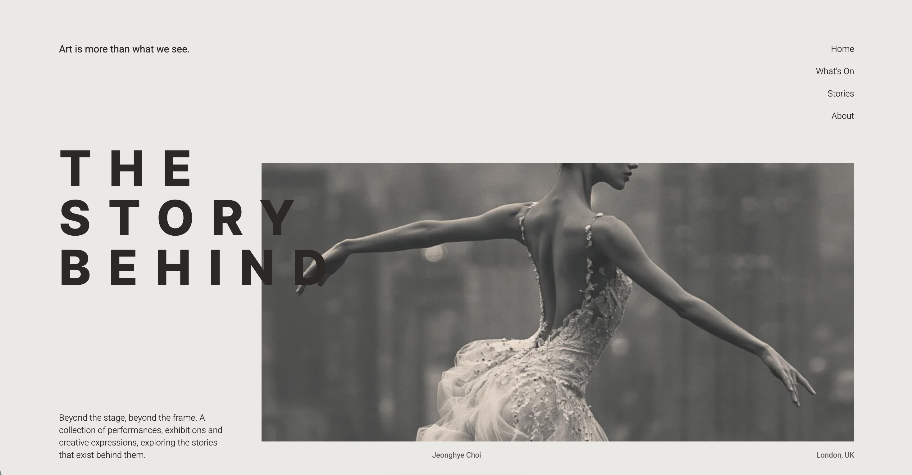

# The Story Behind

**Art is more than what we see.**

An independent art journal based in London, bringing together curated performances, personal reflections, and the stories behind artistic works.

[Explore the journal](https://thestorybehind.jenchoi.dev/)



## Features

- **Performance Discovery** — Curated London performances with genre and date-based filtering.
- **Performance Countdown** — Track ongoing, upcoming, and soon-to-end performances.
- **Performance Archive** — A collection of performances experienced firsthand.
- **Editorial Stories** — Personal reflections, photography, and explorations of art.

## Tech Stack

React · TypeScript · Vite · Tailwind CSS

## Getting Started

```bash
pnpm install
pnpm dev
```

```bash
pnpm check   # Type checking
pnpm build   # Production build
```

## Changelog

Originally launched as _London in Dance_.

See [CHANGELOG.md](./CHANGELOG.md) for release notes.

## Author

Designed, developed, and curated by [Jeonghye Choi](https://jenchoi.dev).
